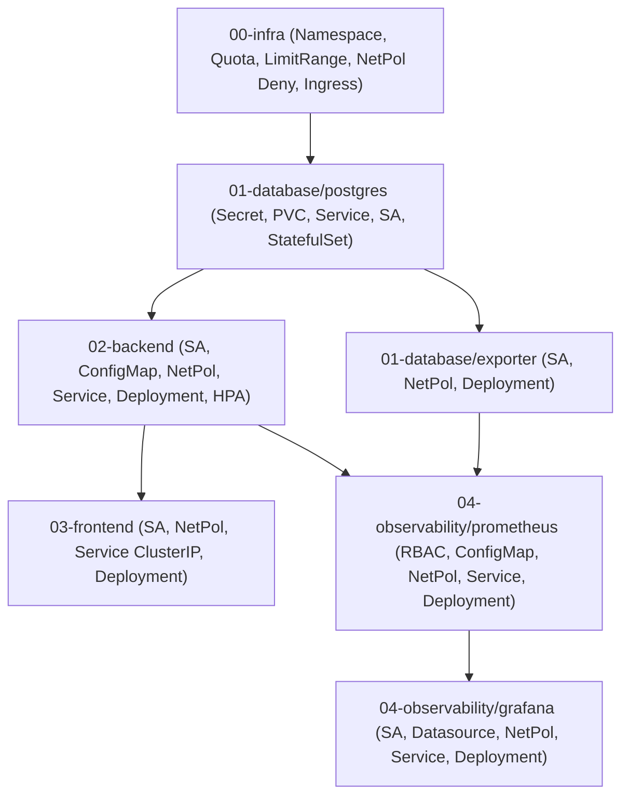

# Kolejność Wdrażania Komponentów (Deployment Dependency Order)

Niniejszy dokument opisuje sekwencję uruchamiania architektury 3-warstwowej w klastrze Kubernetes wraz ze szczegółowym uzasadnieniem zależności architektonicznych.

---

## Graf zależności (Dependency Graph)



---

## Szczegółowa analiza krok po kroku

### Krok 1: Infrastruktura bazowa (`00-infra/`)
* **`00-infra/namespace.yaml`**:
  Musi powstać bezwzględnie jako pierwszy zasób. Wszystkie kolejne manifesty operują w kontekście `namespace: k8s-demo`.
* **`00-infra/resource-quota.yaml` oraz `00-infra/limit-range.yaml`**:
  Muszą zostać zaaplikowane przed utworzeniem jakichkolwiek podów. ResourceQuota definiuje maksymalny bilans zasobów w namespace, a LimitRange narzuca domyślne żądania i limity CPU/RAM kontenerom, które ich nie zdefiniowały.
* **`00-infra/network-policy-default-deny.yaml`**:
  Wzorzec Zero-Trust (Default Deny Ingress). Zaryglowujemy ruch przychodzący w całym namespace zanim w klastrze pojawią się aplikacje.
* **`00-infra/ingress.yaml`**:
  Konfiguracja reguł routingu L7 w kontrolerze Traefik (`/`, `/api`, `/ready`).

```bash
kubectl apply -f 00-infra/
```

---

### Krok 2: Warstwa danych (`01-database/`)
Baza danych musi być w pełni zainicjalizowana przed startem backendu. Backend weryfikuje połączenie z bazą przez sondę gotowości (`/ready`) - jeśli baza nie odpowiada, pody backendu nie wejdą w stan `Ready`.

1. **PostgreSQL (`01-database/postgres/`)**:
   * Utworzenie sekretu z poświadczeniami (`secret.yaml`).
   * Alokacja trwałego wolumenu dyskowego (`pvc.yaml`).
   * Dedykowane konto bez tokena K8s API (`service-account.yaml`).
   * Serwis `postgres-service:5432` (`service.yaml`).
   * Dedykowana polityka sieciowa wpuszczająca backend i eksporter (`network-policy.yaml`).
   * Uruchomienie instancji bazodanowej (`statefulset.yaml`).

2. **Eksporter bazy (`01-database/exporter/`)**:
   * Dedykowane konto `postgres-exporter-service-account` (`service-account.yaml`).
   * Polityka sieciowa wpuszczająca Prometheusa na port 9187 (`network-policy.yaml`).
   * Deployment eksportera (`deployment.yaml`).

```bash
kubectl apply -f 01-database/postgres/
kubectl wait --for=condition=ready pod -l app=postgres -n k8s-demo --timeout=90s
kubectl apply -f 01-database/exporter/
```

---

### Krok 3: Logika biznesowa (`02-backend/`)
Backend odpowiada za obsługę zapytań REST API i logikę aplikacji. Wymaga aktywnego serwisu bazodanowego.

* `service-account.yaml`: Dedykowane konto z `automountServiceAccountToken: false`.
* `configmap.yaml`: Zmienne środowiskowe konfiguracji aplikacji.
* `network-policy.yaml`: Odblokowanie portu 8000 dla Ingress Controllera oraz Prometheusa.
* `service.yaml`: `ClusterIP` kierujący ruch na port 8000.
* `deployment.yaml`: Deployment z utwardzonym `securityContext` (`runAsNonRoot: true`, UID `10001`) i sondami `/healthz` oraz `/ready`.
* `hpa.yaml`: Horizontal Pod Autoscaler monitorujący zużycie CPU (50%) i skalujący pody w zakresie 2-5.

```bash
kubectl apply -f 02-backend/
kubectl wait --for=condition=ready pod -l app=backend -n k8s-demo --timeout=90s
```

---

### Krok 4: Warstwa prezentacji (`03-frontend/`)
Frontend to serwer Nginx serwujący statyczne pliki SPA (HTML, CSS, JS).

* `service-account.yaml`: Izolowane konto serwisowe.
* `network-policy.yaml`: Wpuszczenie ruchu na port 80 wyłącznie z Traefik Ingress.
* `service.yaml`: `ClusterIP` (likwidacja antywzorca NodePort).
* `deployment.yaml`: Kontener Nginx działający jako `runAsNonRoot: true` (UID `101`) z odrzuconymi wszystkimi uprawnieniami (`drop: [ALL]`) i dodanym `NET_BIND_SERVICE`.

```bash
kubectl apply -f 03-frontend/
kubectl wait --for=condition=ready pod -l app=frontend -n k8s-demo --timeout=60s
```

---

### Krok 5: Monitoring i Observability (`04-observability/`)
Warstwa telemetryczna monitorująca stan całego systemu. Wdrażana na końcu, aby mogła od razu wykryć i monitorować działające już komponenty.

1. **Prometheus (`04-observability/prometheus/`)**:
   * `rbac.yaml`: ServiceAccount, ClusterRole i ClusterRoleBinding umożliwiające odpytywanie Kubernetes API o listę podów.
   * `configmap.yaml`: Konfiguracja scrapingu podów z adnotacjami `prometheus.io/scrape: true`.
   * `network-policy.yaml`: Port 9090 dostępny wyłącznie dla Grafany.
   * `service.yaml`: `ClusterIP` na porcie 9090.
   * `deployment.yaml`: Instancja Prometheusa montująca konfigurację.

2. **Grafana (`04-observability/grafana/`)**:
   * `service-account.yaml`: Izolowane konto serwisowe.
   * `datasource.yaml`: Automatyczny provisioning zdefiniowanego źródła danych Prometheus (`http://prometheus-service:9090`).
   * `network-policy.yaml`: Port 3000 dozwolony dla tunelowania administracyjnego.
   * `service.yaml`: `ClusterIP` (dostęp administracyjny przez tunel `port-forward`).
   * `deployment.yaml`: Instancja Grafany.

```bash
kubectl apply -f 04-observability/prometheus/
kubectl apply -f 04-observability/grafana/
kubectl wait --for=condition=ready pod -l app=prometheus -n k8s-demo --timeout=90s
kubectl wait --for=condition=ready pod -l app=grafana -n k8s-demo --timeout=90s
```

---

## Automatyzacja

Pełna powyższa procedura została zautomatyzowana w skrypcie:
```bash
./deploy.sh
```

W celu całkowitego usunięcia wdrożenia:
```bash
./destroy.sh
```
