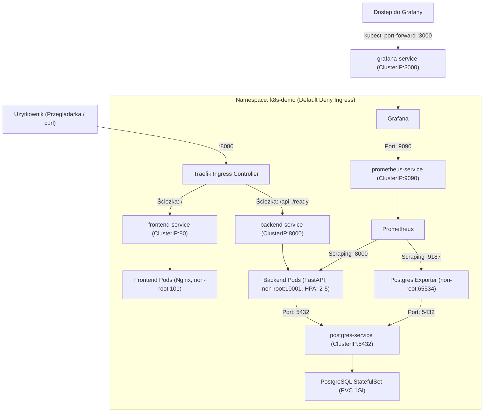
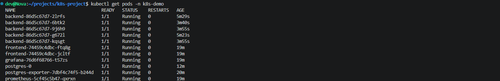
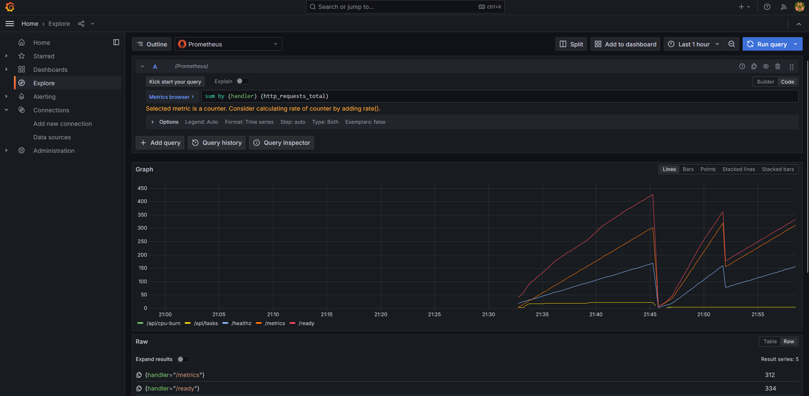
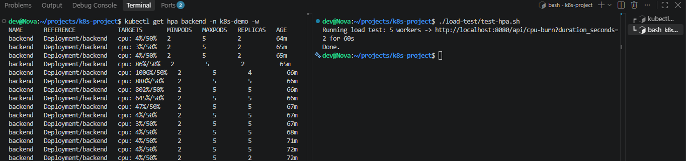

# Aplikacja 3-Warstwowa na Kubernetes (k3d / k3s)

Projekt demonstracyjny 3-warstwowej aplikacji (Frontend, Backend, Baza danych) uruchomionej na lokalnym klastrze Kubernetes z monitoringiem (Prometheus, Grafana), autoskalowaniem podów (HPA) oraz politykami sieciowymi (NetworkPolicy).

---

## O Aplikacji (Co to jest i co robi?)

Aplikacja to prosty **Task Manager (menedżer zadań)**:
* **Frontend:** Jednostronicowa aplikacja (SPA) serwowana przez Nginx. Pozwala dodawać, przeglądać i usuwać zadania z bazy danych, wyświetla status połączenia z backendem i bazą oraz posiada przycisk do generowania obciążenia CPU.
* **Backend:** REST API w Pythonie (FastAPI) komunikujące się z bazą danych PostgreSQL. Udostępnia endpointy:
  * `GET, POST, DELETE /api/tasks` – operacje CRUD na zadaniach.
  * `GET /healthz` – sonda liveness (sprawdza czy proces Pythona żyje).
  * `GET /ready` – sonda readiness (wykonuje zapytanie testowe `SELECT 1` do Postgresa).
  * `GET /api/cpu-burn` – pętla obliczeniowa obciążająca CPU na 2 sekundy (używana do testowania HPA).
  * `GET /metrics` – metryki aplikacji dla Prometheusa.
* **Baza danych:** PostgreSQL przechowujący tabelę `tasks`.

---

## Architektura i Rola Poszczególnych Komponentów

Krótkie wyjaśnienie, do czego służy każdy element w projekcie:

### 1. `00-infra/` (Infrastruktura bazowa)
* **`namespace.yaml`:** Logiczna izolacja całego projektu (`k8s-demo`) od innych aplikacji w klastrze.
* **`resource-quota.yaml`:** Twardy limit zasobów na cały namespace (maksymalnie 4 CPU i 4Gi RAM), żeby aplikacja nie zajęła wszystkich zasobów klastra.
* **`limit-range.yaml`:** Domyślne wartości `requests` i `limits` dla każdego poda, jeśli nie zostały wpisane w jego manifeście.
* **`ingress.yaml`:** Pojedyncza brama wejściowa L7 (Traefik). Odbiera ruch na porcie 8080 i rozdziela go: ścieżkę `/` kieruje do frontendu, a `/api` oraz `/ready` bezpośrednio do backendu.
* **`network-policy-default-deny.yaml`:** Domyślny firewall odcinający 100% ruchu przychodzącego do wszystkich podów w namespace.

### 2. `01-database/` (Warstwa danych)
* **`postgres/statefulset.yaml`:** Baza danych wymaga stałej nazwy (`postgres-0`) i nie może być restartowana jak zwykły bezstanowy pod, dlatego użyto `StatefulSet` zamiast `Deploymentu`.
* **`postgres/pvc.yaml`:** Trwały dysk (1Gi) montowany w `/var/lib/postgresql/data`. Dzięki temu dane w bazie nie znikają po restarcie czy awarii poda.
* **`postgres/secret.yaml`:** Bezpieczne przekazanie loginu i hasła do bazy w zmiennych środowiskowych.
* **`postgres/network-policy.yaml`:** Zezwala na ruch na port 5432 wyłącznie z podów backendu oraz eksportera metryk.
* **`exporter/` (Postgres Exporter):** Kontener pomocniczy odpytujący bazę SQL o stan połączeń i transakcji, wystawiający metryki dla Prometheusa na porcie 9187. Posiada własne konto `service-account.yaml` oraz osobną politykę sieciową.

### 3. `02-backend/` (Logika biznesowa)
* **`deployment.yaml`:** Aplikacja bezstanowa (FastAPI). Może być swobodnie skalowana w górę i w dół.
* **Sondy `/healthz` i `/ready`:** 
  * Jeśli proces Pythona się zawiesi, Kubernetes go zrestartuje (`livenessProbe`).
  * Jeśli baza danych jeszcze nie wstała lub ma awarię, pod nie dostanie ruchu od użytkowników (`readinessProbe`).
* **`hpa.yaml`:** Horizontal Pod Autoscaler – gdy średnie obciążenie CPU na backendzie przekroczy 50%, automatycznie skaluje liczbę podów z 2 do maksymalnie 5.
* **`network-policy.yaml`:** Zezwala na ruch na port 8000 wyłącznie z Ingressa (zapytania użytkowników) oraz z Prometheusa (pobieranie metryk).

### 4. `03-frontend/` (Warstwa prezentacji)
* **`deployment.yaml`:** Serwer Nginx serwujący statyczny HTML i JS. Działa jako użytkownik nie-root (`runAsUser: 101`) z uprawnieniem `NET_BIND_SERVICE` do portu 80.
* **`network-policy.yaml`:** Zezwala na ruch na port 80 wyłącznie z Ingress Controllera.

### 5. `04-observability/` (Monitoring)
* **`prometheus/`:** Co 5 sekund automatycznie odpytuje pody oznaczone adnotacją `prometheus.io/scrape: true` (backend na porcie 8000 i eksporter na porcie 9187) i zapisuje metryki w czasie. Posiada reguły RBAC do odpytywania API Kubernetes o listę podów.
* **`grafana/`:** Narzędzie do wizualizacji metryk na wykresach. Posiada automatycznie skonfigurowane źródło danych Prometheus (`datasource.yaml`).

---

## Schemat Połączeń Sieciowych



---

## Wprowadzone Poprawki i Decyzje Architektoniczne

Podczas przeglądu i budowy projektu rozwiązano następujące kwestie:

### 1. Zmiana serwisów z NodePort na ClusterIP
* **Jak było:** Frontend i Grafana miały ustawiony `type: NodePort`.
* **Dlaczego zmieniono:** Skoro mamy Ingress (Traefik), ruch z zewnątrz powinien wchodzić wyłącznie przez Ingress na `ClusterIP`. `NodePort` na frontendzie był zbędny i otwierał niepotrzebny port na węźle.
* **Co zrobiono:** Frontend i Grafana zostały przestawione na `ClusterIP`. Dostęp do Grafany realizowany jest lokalnie przez `kubectl port-forward`.

### 2. Rozdzielenie Postgres Exportera i dedykowany ServiceAccount
* **Jak było:** Exporter bazy był w jednym folderze z bazą, współdzielił z nią plik `network-policy.yaml` i nie miał własnego ServiceAccount (używał domyślnego konta K8s z zamontowanym tokenem API).
* **Co zrobiono:** Folder `01-database/` podzielono na `postgres/` i `exporter/`. Exporter otrzymał dedykowany ServiceAccount z wyłączonym tokenem API (`automountServiceAccountToken: false`) oraz osobną politykę sieciową (port 9187 dostępny tylko dla Prometheusa).

### 3. Uruchamianie kontenerów jako zwykły użytkownik (non-root)
* **Jak było:** Kontenery nie miały zdefiniowanych ograniczeń użytkownika w `securityContext`.
* **Co zrobiono:** Wymuszono `runAsNonRoot: true`, przypisano bezpieczne identyfikatory UID (`10001` backend, `101` frontend, `65534` exporter). W Nginxie dodano uprawnienie `NET_BIND_SERVICE` i zrzucono pozostałe (`drop: ALL`), co pozwala na bindowanie portu 80 bez roota.

### 4. Domyślna blokada ruchu sieciowego (Default Deny Ingress)
* **Zasada działania:** W pliku `00-infra/network-policy-default-deny.yaml` zdefiniowano pusty selektor `podSelector: {}` oraz `policyTypes: [Ingress]` bez żadnych reguł zezwalających.
* **Efekt:** Cały ruch przychodzący w namespace jest domyślnie zablokowany. Pakiety docierają tylko tam, gdzie jawnie istnieje zezwalająca NetworkPolicy (np. backend -> baza, ingress -> frontend).

### 5. Ochrona haseł przed wrzuceniem do Gita
* **Sytuacja:** Plik `01-database/postgres/secret.yaml` po przeniesieniu do podfolderu został omyłkowo dodany do Gita – narzędzie Gitleaks zablokowało commit.
* **Rozwiązanie:** Zaktualizowano `.gitignore` o wpis `**/secret.yaml`. W repozytorium znajduje się wyłącznie szablon `secret.example.yaml`.

---

## Struktura Katalogów

```text
.
├── 00-infra/
│   ├── ingress.yaml                         # Ingress Traefik (/, /api, /ready)
│   ├── limit-range.yaml                     # Domyślne limity pamięci i CPU
│   ├── namespace.yaml                       # Namespace k8s-demo
│   ├── network-policy-default-deny.yaml     # Domyślna blokada ruchu przychodzącego
│   └── resource-quota.yaml                  # Limity zasobów dla namespace
├── 01-database/
│   ├── exporter/
│   │   ├── deployment.yaml                  # Deployment eksportera metryk
│   │   ├── network-policy.yaml              # Dostęp do portu 9187 z Prometheusa
│   │   └── service-account.yaml             # Konto z wyłączonym tokenem API
│   └── postgres/
│       ├── network-policy.yaml              # Dostęp do bazy (5432) z backendu i eksportera
│       ├── pvc.yaml                         # Dysk 1Gi na dane bazy
│       ├── secret.example.yaml              # Przykładowy plik z hasłami
│       ├── service-account.yaml             # Konto dla bazy
│       ├── service.yaml                     # Serwis postgres-service (ClusterIP:5432)
│       └── statefulset.yaml                 # StatefulSet PostgreSQL z probe'ami
├── 02-backend/
│   ├── configmap.yaml                       # Zmienne konfiguracyjne
│   ├── deployment.yaml                      # Aplikacja FastAPI (UID 10001, non-root)
│   ├── hpa.yaml                             # Autoskaler CPU 50% (od 2 do 5 podów)
│   ├── network-policy.yaml                  # Dostęp z Ingressa i Prometheusa
│   ├── service-account.yaml                 # Dedykowane konto
│   └── service.yaml                         # Serwis backend-service (ClusterIP:8000)
├── 03-frontend/
│   ├── deployment.yaml                      # Nginx (UID 101, NET_BIND_SERVICE)
│   ├── network-policy.yaml                  # Dostęp z Ingressa (port 80)
│   ├── service-account.yaml                 # Dedykowane konto
│   └── service.yaml                         # Serwis frontend-service (ClusterIP:80)
├── 04-observability/
│   ├── grafana/
│   │   ├── datasource.yaml                  # Automatyczne spięcie z Prometheusem
│   │   ├── deployment.yaml                  # Deployment Grafany
│   │   ├── network-policy.yaml              # Dostęp do portu 3000
│   │   ├── service-account.yaml             # Dedykowane konto
│   │   └── service.yaml                     # Serwis grafana-service (ClusterIP:3000)
│   └── prometheus/
│       ├── configmap.yaml                   # Konfiguracja scrapowania podów
│       ├── deployment.yaml                  # Deployment Prometheusa
│       ├── network-policy.yaml              # Dostęp do portu 9090 z Grafany
│       ├── rbac.yaml                        # Uprawnienia do odpytywania podów w K8s
│       └── service.yaml                     # Serwis prometheus-service (ClusterIP:9090)
├── load-test/
│   └── test-hpa.sh                          # Skrypt obciążeniowy CPU do testu HPA
├── DEPLOYMENT_ORDER.md                      # Opis kolejności uruchamiania komponentów
├── deploy.sh                                # Skrypt uruchamiający cały projekt
└── destroy.sh                               # Skrypt usuwający wdrożenie
```

---

## Uruchomienie Projektu

### 1. Automatyczne wdrożenie
Do uruchomienia całego klastra służy skrypt:

```bash
./deploy.sh
```

Skrypt po kolei tworzy zasoby i czeka na gotowość podów (`kubectl wait`).

*(Jeśli chcesz uruchamiać poszczególne pliki ręcznie, pełny opis kolejności znajdziesz w pliku `DEPLOYMENT_ORDER.md`).*

### 2. Sprawdzenie stanu aplikacji
```bash
kubectl get pods -n k8s-demo
kubectl get svc -n k8s-demo
```

Wszystkie serwisy powinny mieć typ `ClusterIP`.



### 3. Otwarcie aplikacji w przeglądarce
* **Frontend:** http://localhost:8080/
* **Backend API:** http://localhost:8080/api
* **Sonda gotowości (baza i backend):** http://localhost:8080/ready

### 4. Otwarcie Grafany
Ponieważ Grafana jest wewnątrz klastra (`ClusterIP`), łączymy się z nią przez tunel:

```bash
kubectl port-forward svc/grafana-service 3000:3000 -n k8s-demo
```

Adres: http://localhost:3000  
Login: `admin`, hasło: `admin`.



---

## Test Autoskalowania (HPA)

W projekcie skonfigurowano HPA, który skaluje pody backendu przy obciążeniu CPU powyżej 50%:

1. W jednym terminalu włącz podgląd HPA:
   ```bash
   kubectl get hpa backend -n k8s-demo -w
   ```

2. W drugim terminalu uruchom skrypt generujący ruch:
   ```bash
   ./load-test/test-hpa.sh
   ```

Skrypt wysyła równoległe zapytania do endpointu `/api/cpu-burn`. W terminalu z HPA zobaczysz wzrost zużycia CPU i zwiększenie liczby podów z 2 do 5. Po zakończeniu testu liczba podów samoczynnie wróci do 2.



---

## Usunięcie Projektu

Aby wyczyścić klaster:

```bash
./destroy.sh
```
